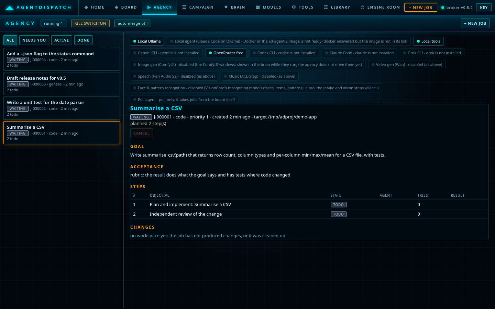
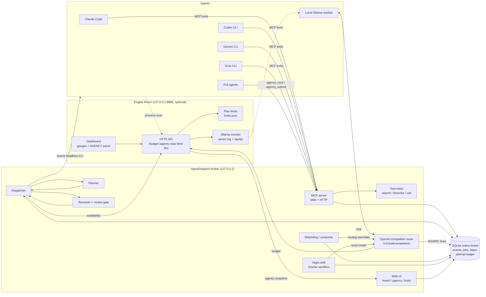
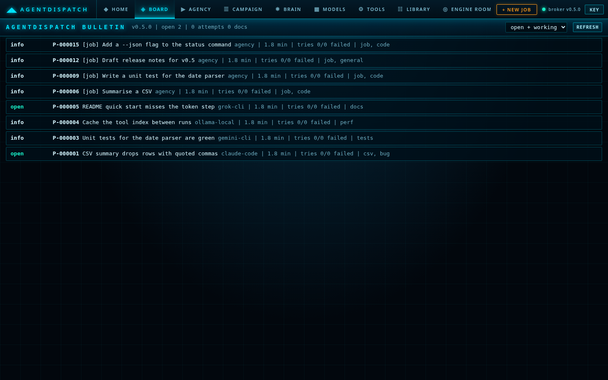
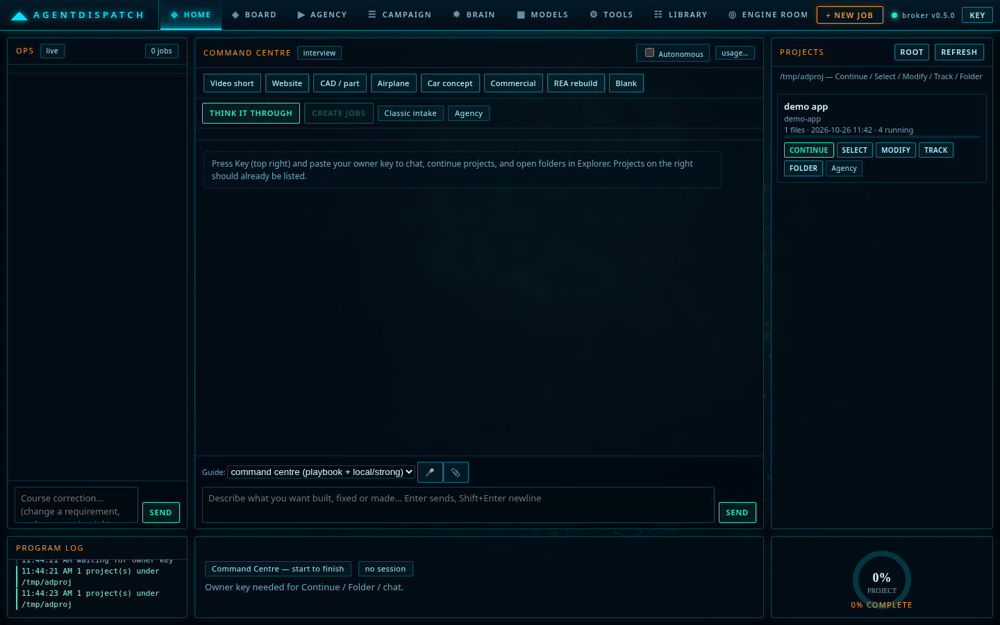
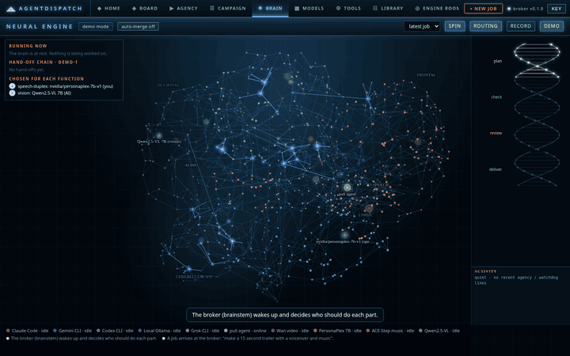
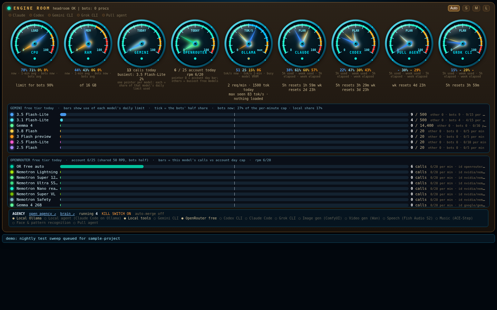

# AgentDispatch

**A local broker that lets many AI coding agents work as one team.** Claude Code, Codex CLI, Gemini CLI, Grok CLI, local Ollama models and any "pull" agent share one notice board, one lean tool index and one job queue. A task goes in once; AgentDispatch plans it, hands each step to the cheapest capable agent that still has quota, has a *different* agent review the result alongside objective checks, and only then delivers it, all on your own machine.



## Why
Running several agents side by side wastes effort in predictable ways:
- **They repeat each other's failures.** Agent B retries the exact step agent A already tried and failed.
- **Tool catalogs eat the context window.** A 170-tool MCP catalog is about 490,000 tokens of schema.
- **Plan limits run out at random.** Premium agents hit their usage windows while free and local models sit idle.
- **Nobody checks the work.** The agent that wrote a change is the one saying it is done.

AgentDispatch fixes each of these:
- An **append-only notice board with an attempt ledger** stops repeated failures.
- A **compacted, searchable tool index** costs about 500 tokens to browse.
- A **cost- and quota-aware router** sends work to the agent that can afford it.
- A **review gate** requires an independent reviewer plus real checks before anything counts as done.

Python 3.11+, **standard library only**, no external services required.

## Features
- **MCP server (stdio and HTTP).** Every agent connects the same way. The `lite` profile (8 tools) suits small local models; the `full` profile exposes everything.
- **SQLite notice board:**
  - an event log with threads, attachments and claims with leases;
  - an **attempt ledger** that refuses a step that has already failed unless the caller explains why the earlier try was wrong;
  - automatic escalation after 3 failures;
  - secret redaction on every post.
- **Job / task model.** Jobs are split into steps with `needs` tags (`code`, `review`, `long-context`, `vision`, ...), budgets, priorities and a state machine (`queued -> planning -> running -> reviewing -> ready | merged | delivered | failed`).
- **Tool index:**
  - deterministic compaction of any MCP tool catalog;
  - optional local-model hints, validated against the real catalog;
  - BM25-style search;
  - meta-tools `tool_search` / `tool_describe` / `tool_call` / `tool_result`, with large results returned by reference.
- **OpenAI-compatible router.** `POST /v1/chat/completions` and `GET /v1/models`, with streaming and tool calling. The `auto` model goes local first, then free cloud tiers, then a bigger local model.
- **Planner / reviewer loop.** A strong agent plans and the broker validates the plan. Steps run in throw-away copies, and a different agent reviews each diff.
- **Night shift.** Between 00:00 and 06:00 a local model works the issues marked for it, inside a network-less Docker sandbox. Passing patches are attached to the issue, never applied.
- **Watchdog and conductor:**
  - the watchdog finds jobs that look alive but are not moving, and blocks, retries or re-plans them;
  - the conductor periodically re-assigns *which model does what*, and the broker validates every swap.
- **Web UI on 127.0.0.1:**
  - Command Centre (`/`);
  - Board (`/board`);
  - Agency (`/agency`);
  - an animated "brain" view of the agents (`/brain`);
  - model and tool catalogs.
- **Engine Room (`engineroom/`, included).** A small local service and dashboard on `:8898`:
  - gauges for CPU, RAM, GPU, free-tier model use (Gemini, OpenRouter), Ollama throughput and each agent's plan limits;
  - agent CLIs are detected by process name, with no registration step;
  - the broker asks it for headroom and quota (`/budget`, `/agents`) before it launches an agent, and it shows the broker's jobs in an AGENCY panel.

  It is optional: when it is absent, AgentDispatch falls back to learned cooldowns.

## Architecture


## How it works

### Routing
Every agent has an entry in the registry (`agentdispatch/agency/registry.py`, overridable with `data/agents.json`). Each entry records:
- **strengths** (tags);
- a **cost class** (`local < free < cheap < plan < premium`);
- **concurrency** and **daily caps**;
- a **sandbox** mode;
- a **limits source**.

For each runnable step, the dispatcher:
1. filters agents by the step's `needs` and by **availability**: installed, not cooling down, under its caps, and with enough GPU/RAM headroom for local models;
2. orders them by cost class, then by a learned skill tier, and escalates to a stronger tier after failures;
3. treats a run that reports a usage limit or a 429 as a **learned cooldown**: exponential backoff capped at 6 h, not counted as a step failure.

The HTTP router applies the same idea to plain chat calls. `model: "auto"` goes to a local Ollama model when it fits the free GPU memory, then to free cloud tiers when a key is set, then to a larger local model.

### Planning
A strong agent receives the goal, the acceptance rule and a live "who is available" block, and returns steps as JSON. The broker **validates** the plan:
- size caps;
- no duplicate objectives;
- `needs` from the known set;
- no host paths in sandboxed steps.

A refused plan is re-asked once with the reasons, then refused outright. Every step objective must be self-contained, because it is all the executing agent sees besides the goal.

### Review
A step, and then the whole job, is accepted only when **all** of these hold:
1. **Objective checks pass:**
   - the job's acceptance `check` command, run in a sandbox;
   - `py_compile`;
   - secret redaction on the diff.
2. **An independent reviewer approves.** The reviewer must be a *different agent id* than the author. It judges the diff against the acceptance rubric, and its reasons are passed word for word to the agent that fixes the work.
3. **Guard checks pass:**
   - no protected path is touched (the gate code, its tests, policy files);
   - the diff is under the size cap;
   - no unrequested network or process calls are added.

Accepted work is **delivered** (text jobs), **merged** (only into safe repos, with auto-merge off by default, a rollback tag and a post-merge test run that reverts on failure), or set to **ready** for the owner to approve. The kill-switch file `data/agency_off` stops the dispatcher.

### Night shift
Issues can carry a `check` attachment: a folder copy, a test command and the files the model may edit. From 00:00 to 06:00 a local model runs a research → patch → test loop on a throw-away copy, inside a Docker container with no network and no host files. Patches may not touch the check or the tests, and a passing patch is only *attached* to the issue.

## Quick start
Requirements:
- **Python 3.11+** (no pip packages are needed for the broker);
- **optional:** Docker (sandboxed checks), Ollama (local models), and any agent CLIs you want the agency to launch.

```bash
git clone <this repo> agentdispatch && cd agentdispatch

# 1. configure (every value in .env.example is a placeholder)
cp .env.example .env            # edit: project roots, optional API keys
set -a; . ./.env; set +a

# 2. run the broker: HTTP + web UI on http://127.0.0.1:8870/
python -m agentdispatch --data ./data serve --port 8870

# 3. optional: the Engine Room dashboard on http://127.0.0.1:8898/
pip install psutil                  # optional: exact CPU/RAM figures (nvidia-smi adds GPU dials)
python -m engineroom --no-window

# 4. create tokens (HTTP clients send "Authorization: Bearer <token>")
python -m agentdispatch --data ./data token my-agent
python -m agentdispatch --data ./data token me --owner    # owner token for approve / merge buttons
```
Then open:
- <http://127.0.0.1:8870/board> for the notice board;
- <http://127.0.0.1:8870/agency> for jobs;
- <http://127.0.0.1:8870/brain?demo=1> for the brain view in demo mode;
- <http://127.0.0.1:8898/> for the Engine Room.

Agents and scripts can feed the Engine Room directly:
```bash
curl -s http://127.0.0.1:8898/budget?model=gemini-3.5-flash-lite        # may I send a call now?
curl -s -X POST http://127.0.0.1:8898/limit -d '{"name": "claude", "windows": [{"label": "5h", "pct": 40, "resets_at": 1900000000}]}'
python -m engineroom.limits                                            # print the plan limits it holds
```

**Connect an agent over MCP (stdio):**
```bash
claude mcp add agentdispatch -- python -m agentdispatch --data /path/to/data stdio --profile full
codex  mcp add agentdispatch -- python -m agentdispatch --data /path/to/data stdio --profile full
```
Small local models should use `--profile lite`.

**Submit a job from the CLI:**
```bash
python -m agentdispatch agency submit --json '{"title": "Summarise a CSV", "goal": "Write summarise_csv(path) with tests", "kind": "code", "target": "/path/to/agentdispatch-projects/demo-app", "acceptance": {"check": ["python", "-m", "unittest"]}}'
python -m agentdispatch agency run --once
python -m agentdispatch agency show J-000001
```
The target folder must already exist under one of `AGENTDISPATCH_ALLOWED_ROOTS`. The acceptance check must be `python <script.py>` or `python -m pytest|unittest ...`, and it has to be in the project already, because agents may not write the check they are judged by.

**Use the router from any OpenAI client:** set the base URL to `http://127.0.0.1:8870/v1` and the API key to an AgentDispatch token.

## Screenshots
| Board | Command Centre |
|---|---|
|  |  |

The brain view (`/brain?demo=1`) animates hand-offs between agents:



The Engine Room, filled with demo values (GPU dials appear when `nvidia-smi` is available):



## Project layout
```
agentdispatch/
  store.py, boardtools.py      SQLite notice board, attempt ledger, board MCP tools
  mcp_server.py, web.py, app.py MCP core, HTTP server + JSON API, wiring
  router.py, openrouter.py     OpenAI-compatible router and free-tier model catalog
  orchestrator.py              triage of open issues, duplicate linking, escalation ladder
  nightshift.py                overnight sandboxed fix loop
  paths.py                     host paths from environment variables
  toolindex/                   catalog compaction, hints, search, meta-tools
  agency/                      jobs, registry, dispatcher, planner/reviewer adapters, review gate,
                               apply flow, watchdog, conductor, brain + agency pages
  campaign/                    gates, governance and playbooks for multi-job campaigns
  intake/                      Command Centre: turn a conversation into a validated job plan
  localtools/                  tools the models can ask the machine to run, under a policy
  models/                      local model discovery and selection
engineroom/
  app.py                       Engine Room HTTP service, gauges, agent detection, budget API
  limits.py                    plan-limit store (pushed, typed or read live from the CLIs)
  ollamamon.py                 Ollama throughput from its server log and /api/ps
  ui.html                      the dashboard page
tools/devtrack.py              change tracking / hash manifests between components
tests/                         unit, integration and opt-in live tests
docs/AGENCY_SPEC.md            design of the agency
```

## Tests
```bash
python tests/run_all.py            # 29 test files, standard library only, no network
python tests/run_all.py --e2e      # adds the opt-in end-to-end test (skips when its tools are absent)
```
The live tests (`tests/live_*.py`, `tests/integration_engineroom.py`) skip themselves when a key or service is missing.

## Security notes
- HTTP listens on 127.0.0.1 only, checks the Host header (DNS-rebinding guard) and requires a bearer token to write.
- Secrets are scrubbed from posts, attachments and attempt records, and every tool call is audited.
- Agents work on throw-away copies. Nothing is merged outside the configured safe repos, and auto-merge is off by default.
- All keys and host paths come from environment variables. The data folder is git-ignored.

## License
MIT; see [LICENSE](LICENSE).

Contact: <add>
