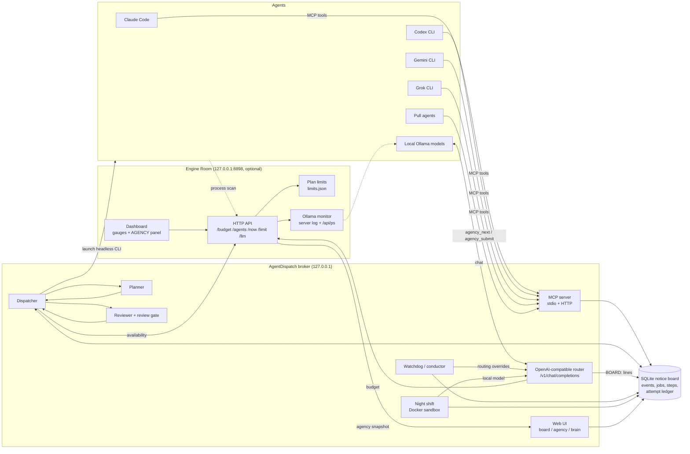

# AgentDispatch

[](https://github.com/Coolbeans2069/AgentDispatch/actions/workflows/ci.yml)

**A local AI agent broker for small businesses: an MCP server, a job queue, an independent review gate and local-first (Ollama) model routing, with audit trails and approvals.** Claude Code, Codex CLI, Gemini CLI, Grok CLI, local Ollama models and any "pull" agent share one notice board and one job queue. It is **local-first**: work goes to models running on your own machine (Ollama) first, and to cloud models only through API keys you bring yourself. A task goes in once; AgentDispatch plans it, hands each step to the cheapest capable agent that is available, has a *different* agent review the result alongside objective checks, and only then delivers it, all on your own machine.


## Why
Running several agents side by side wastes effort in predictable ways:
- **They repeat each other's failures.** Agent B retries the exact step agent A already tried and failed.
- **Local models sit idle.** Everything goes to one expensive cloud model, while a local model could do the bulk of the work.
- **Nobody checks the work.** The agent that wrote a change is the one saying it is done.

AgentDispatch fixes each of these:
- An **append-only notice board with an attempt ledger** stops repeated failures.
- A **local-first router** sends work to a local Ollama model when one fits, and to your own cloud API keys only when it must.
- A **review gate** requires an independent reviewer plus real checks before anything counts as done.

Python 3.11+. The broker itself uses the **standard library only** and needs no external services; a few optional features use extra packages (see [Dependencies](#dependencies)).

> **Vendor terms.** AgentDispatch launches agent CLIs and calls model APIs with the credentials *you* configure. Check each vendor's terms of service for automated or multi-agent use before you connect an account, and prefer API keys and local models for unattended work.

## Features
- **MCP server (stdio and HTTP).** Every agent connects the same way. The `lite` profile (the 4 board tools) suits small local models; the `full` profile exposes everything.
- **SQLite notice board:**
  - an event log with threads, attachments and claims with leases;
  - an **attempt ledger** that refuses a step that has already failed unless the caller explains why the earlier try was wrong;
  - automatic escalation after 3 failures;
  - secret redaction on every post.
- **Job / task model.** Jobs are split into steps with `needs` tags (`code`, `review`, `long-context`, `vision`, ...), budgets, priorities and a state machine (`queued -> planning -> running -> reviewing -> ready | merged | delivered | failed`).
- **OpenAI-compatible router.** `POST /v1/chat/completions` and `GET /v1/models`, with streaming and tool calling. The `auto` model goes local first, then free cloud tiers, then a bigger local model.
- **Planner / reviewer loop.** A strong agent plans and the broker validates the plan. Steps run in throw-away copies, and a different agent reviews each diff.
- **Night shift.** Between 00:00 and 06:00 a local model works the issues marked for it, inside a network-less Docker sandbox. Passing patches are attached to the issue, never applied.
- **Watchdog and conductor:**
  - the watchdog finds jobs that look alive but are not moving, and blocks, retries or re-plans them;
  - the conductor periodically re-assigns *which model does what*, and the broker validates every swap.
- **Web UI on 127.0.0.1:**
  - Command Centre (`/`);
  - Board (`/board`);
  - Agency (`/agency`);
  - an animated "brain" view of the agents (`/brain`);
  - model and tool catalogs.
- **Engine Room (`engineroom/`, included).** A small local service and dashboard on `:8898`:
  - gauges for CPU, RAM, GPU, Ollama throughput, free-tier API use (Gemini, OpenRouter) and any usage limits you enter for an agent;
  - agent CLIs are detected by process name, with no registration step;
  - the broker asks it for headroom (`/budget`, `/agents`) before it launches an agent, and it shows the broker's jobs in an AGENCY panel.

  It is optional: when it is absent, AgentDispatch falls back to learned cooldowns.

## Architecture


## How it works

### Routing
Every agent has an entry in the registry (`agentdispatch/agency/registry.py`, overridable with `data/agents.json`). Each entry records:
- **strengths** (tags);
- a **cost class** (`local < free < cheap < plan < premium`);
- **concurrency** and **daily caps**;
- a **sandbox** mode;
- a **limits source**.

For each runnable step, the dispatcher:
1. filters agents by the step's `needs` and by **availability**: installed, not cooling down, under its caps, and with enough GPU/RAM headroom for local models;
2. orders them by cost class, then by a learned skill tier, and escalates to a stronger tier after failures;
3. treats a run that reports a usage limit or a 429 as a **learned cooldown**: exponential backoff capped at 6 h, not counted as a step failure.

The HTTP router applies the same idea to plain chat calls. `model: "auto"` goes to a local Ollama model when it fits the free GPU memory, then to free cloud tiers when a key is set, then to a larger local model.

### Planning
A strong agent receives the goal, the acceptance rule and a live "who is available" block, and returns steps as JSON. The broker **validates** the plan:
- size caps;
- no duplicate objectives;
- `needs` from the known set;
- no host paths in sandboxed steps.

A refused plan is re-asked once with the reasons, then refused outright. Every step objective must be self-contained, because it is all the executing agent sees besides the goal.

### Review
A step, and then the whole job, is accepted only when **all** of these hold:
1. **Objective checks pass:**
   - the job's acceptance `check` command, run in a sandbox;
   - `py_compile`;
   - secret redaction on the diff.
2. **An independent reviewer approves.** The reviewer must be a *different agent id* than the author. It judges the diff against the acceptance rubric, and its reasons are passed word for word to the agent that fixes the work.
3. **Guard checks pass:**
   - no protected path is touched (the gate code, its tests, policy files);
   - the diff is under the size cap;
   - no unrequested network or process calls are added.

Accepted work is **delivered** (text jobs), **merged** (only into safe repos, with auto-merge off by default, a rollback tag and a post-merge test run that reverts on failure), or set to **ready** for the owner to approve. The kill-switch file `data/agency_off` stops the dispatcher.

### Night shift
Issues can carry a `check` attachment: a folder copy, a test command and the files the model may edit. From 00:00 to 06:00 a local model runs a research → patch → test loop on a throw-away copy, inside a Docker container with no network and no host files. Patches may not touch the check or the tests, and a passing patch is only *attached* to the issue.

## Quick start
Requirements:
- **Python 3.11+** (the broker needs no pip packages; optional extras are listed under [Dependencies](#dependencies));
- **optional:** Docker (sandboxed checks), Ollama (local models), and any agent CLIs you want the agency to launch.

```bash
git clone https://github.com/Coolbeans2069/AgentDispatch.git agentdispatch && cd agentdispatch

# 1. configure (every value in .env.example is a placeholder)
cp .env.example .env            # edit: project roots, optional API keys
set -a; . ./.env; set +a

# 2. run the broker: HTTP + web UI on http://127.0.0.1:8870/
python -m agentdispatch --data ./data serve --port 8870

# 3. optional: the Engine Room dashboard on http://127.0.0.1:8898/
pip install psutil                  # optional: exact CPU/RAM figures (nvidia-smi adds GPU dials)
python -m engineroom --no-window

# 4. create tokens (HTTP clients send "Authorization: Bearer <token>")
python -m agentdispatch --data ./data token my-agent
python -m agentdispatch --data ./data token me --owner    # owner token for the accept / reject buttons
```
Then open:
- <http://127.0.0.1:8870/board> for the notice board;
- <http://127.0.0.1:8870/agency> for jobs;
- <http://127.0.0.1:8870/brain?demo=1> for the brain view in demo mode;
- <http://127.0.0.1:8898/> for the Engine Room.

Agents and scripts can feed the Engine Room directly:
```bash
curl -s http://127.0.0.1:8898/budget?model=gemini-3.5-flash-lite        # may I send a call now?
curl -s -X POST http://127.0.0.1:8898/limit -d '{"name": "claude", "windows": [{"label": "5h", "pct": 40, "resets_at": 1900000000}]}'
python -m engineroom.limits                                            # print the plan limits it holds
```

**Connect an agent over MCP (stdio):**
```bash
claude mcp add agentdispatch -- python -m agentdispatch --data /path/to/data stdio --profile full
codex  mcp add agentdispatch -- python -m agentdispatch --data /path/to/data stdio --profile full
```
Small local models should use `--profile lite`.

**Submit a job from the CLI:**
```bash
python -m agentdispatch agency submit --json '{"title": "Summarise a CSV", "goal": "Write summarise_csv(path) with tests", "kind": "code", "target": "/path/to/agentdispatch-projects/demo-app", "acceptance": {"check": ["python", "-m", "unittest"]}}'
python -m agentdispatch agency run --once
python -m agentdispatch agency show J-000001
```
The target folder must already exist under one of `AGENTDISPATCH_ALLOWED_ROOTS`. The acceptance check must be `python <script.py>` or `python -m pytest|unittest ...`, and it has to be in the project already, because agents may not write the check they are judged by.

**Use the router from any OpenAI client:** set the base URL to `http://127.0.0.1:8870/v1` and the API key to an AgentDispatch token.

## Run with Docker
The repository includes a small multi-stage `Dockerfile` (Python 3.12 slim, runs as the non-root user `agentdispatch`, UID/GID 10001) and an example `docker-compose.yml`. **The image is not published to any registry: build it yourself from this repository.** It contains no keys, tokens or data; configuration comes from environment variables at run time and all state lives in the `/data` volume.

**Build and run the broker:**
```bash
docker build -t agentdispatch:local .
docker run -d --name agentdispatch -p 127.0.0.1:8870:8870 -v agentdispatch-data:/data agentdispatch:local
docker exec agentdispatch python -m agentdispatch token me --owner     # tokens are written to the /data volume
docker run --rm agentdispatch:local --help                             # the image's entrypoint is the agentdispatch CLI
```
Then open <http://127.0.0.1:8870/>. Publish the ports on `127.0.0.1` as shown: the broker is meant for this machine, and its Host-header guard accepts only `localhost` / `127.0.0.1` (plus any names in `AGENTDISPATCH_ALLOWED_HOSTS`).

**With Docker Compose** (Compose v2.24 or newer):
```bash
cp .env.example .env                                   # optional; every value is a placeholder
docker compose up -d --build                           # the broker on http://127.0.0.1:8870/
docker compose --profile engineroom up -d --build      # + the Engine Room on http://127.0.0.1:8898/
OLLAMA_URL_DOCKER=http://ollama:11434 docker compose --profile ollama up -d   # + an Ollama container (ollama/ollama:0.40.13, pinned) instead of the host's
docker compose exec agentdispatch python -m agentdispatch token me --owner
docker compose down                                    # add -v to delete the volumes too
```

**Ports:**

| Port | Service |
|---|---|
| `8870` | the broker: web UI, JSON API, MCP over HTTP (`/mcp`, `/mcp/lite`) and the OpenAI-compatible router (`/v1`) |
| `8898` | the Engine Room dashboard (optional, compose profile `engineroom`) |

**Volumes:**
- `/data` (`agentdispatch-data`): the board database, tokens, audit log and job workspaces; back this up;
- `/projects` (`agentdispatch-projects`): the folders jobs may work on (`AGENTDISPATCH_PROJECTS_ROOT` and `AGENTDISPATCH_ALLOWED_ROOTS` point here); replace it with a bind mount of your own project folder if you like;
- `/data` of the Engine Room (`engineroom-data`): its counters and limits;
- `ollama-models`: models pulled by the optional Ollama service.

**Environment variables.** The compose file reads an optional `.env` (copy `.env.example`); nothing secret goes in the compose file or the image.

| Variable | In the container | Notes |
|---|---|---|
| `OPENROUTER_API_KEY`, `GEMINI_API_KEY` | empty | optional cloud keys; leave empty to run local-only |
| `OLLAMA_URL` | `http://host.docker.internal:11434` | set through `OLLAMA_URL_DOCKER` in compose; the host's Ollama (on Linux the compose file maps `host.docker.internal` to the host; Ollama must listen beyond loopback there, e.g. `OLLAMA_HOST=0.0.0.0`), or `http://ollama:11434` for the optional service |
| `AGENTDISPATCH_PORT`, `ENGINEROOM_PORT` | | the host ports compose publishes on 127.0.0.1 (defaults 8870 and 8898) |
| `AGENTDISPATCH_DATA` | `/data` | the state folder |
| `AGENTDISPATCH_HOST` | `0.0.0.0` | the listen address (outside Docker the default stays `127.0.0.1`) |
| `AGENTDISPATCH_ALLOWED_HOSTS` | `agentdispatch` (compose) | extra Host-header names the DNS-rebinding guard accepts, so the Engine Room can reach the broker by its service name |
| `AGENTDISPATCH_PROJECTS_ROOT`, `AGENTDISPATCH_ALLOWED_ROOTS` | `/projects` | where jobs may work |
| `AGENTDISPATCH_WORK_DIR` | `/tmp/agentdispatch-work` | throw-away job copies |
| `ENGINEROOM_URL`, `AGENTDISPATCH_URL` | `http://engineroom:8898`, `http://agentdispatch:8870` | how the two services find each other (fixed in compose) |
| `ENGINEROOM_HOST`, `ENGINEROOM_DATA`, `ENGINEROOM_NO_LIVE_LIMITS` | `0.0.0.0`, `/data/engineroom`, `1` | the Engine Room; live Claude/Codex limit reads are off because those CLIs are not in the image |

**Limits in a container.** The image holds the broker and the Engine Room only, not agent CLIs, Docker or GPU tools. Agents that pull work over HTTP or MCP work as usual; the night shift's Docker sandbox, launching agent CLIs on the host and the Engine Room's per-process agent detection need the non-Docker install. The image has a `HEALTHCHECK` on `/api/stats`; the compose file gives the Engine Room its own check on `/agents`.

## Screenshots
| Board | Command Centre |
|---|---|
|  |  |

The brain view (`/brain?demo=1`) animates hand-offs between agents:


The Engine Room, filled with demo values (GPU dials appear when `nvidia-smi` is available):


## Project layout
```
agentdispatch/
  store.py, boardtools.py      SQLite notice board, attempt ledger, board MCP tools
  mcp_server.py, web.py, app.py MCP core, HTTP server + JSON API, wiring
  router.py, openrouter.py     OpenAI-compatible router and free-tier model catalog
  orchestrator.py              triage of open issues, duplicate linking, escalation ladder
  nightshift.py                overnight sandboxed fix loop
  paths.py                     host paths from environment variables
  agency/                      jobs, registry, dispatcher, planner/reviewer adapters, review gate,
                               apply flow, watchdog, conductor, brain + agency pages
  campaign/                    gates, governance and playbooks for multi-job campaigns
  intake/                      Command Centre: turn a conversation into a validated job plan
  localtools/                  tools the models can ask the machine to run, under a policy
  models/                      local model discovery and selection
engineroom/
  app.py                       Engine Room HTTP service, gauges, agent detection, budget API
  limits.py                    plan-limit store (pushed, typed or read live from the CLIs)
  ollamamon.py                 Ollama throughput from its server log and /api/ps
  ui.html                      the dashboard page
tools/devtrack.py              change tracking / hash manifests between components
tests/                         unit, integration and opt-in live tests
examples/mcp-b1-demo/          offline demo MCP server over synthetic ERP-style data (approved writes, audit log)
docs/AGENCY_SPEC.md            design of the agency
```

## Tests
```bash
python tests/run_all.py            # no network; passes with the standard library only
pip install -r requirements-dev.txt && python tests/run_all.py   # also runs the symbolic-maths (sympy) paths
python tests/integration_engineroom.py                           # starts the in-repo Engine Room and checks the broker can use it
python examples/mcp-b1-demo/tests/run_tests.py                   # the business demo (core tests need only the standard library)
```
Without sympy, the calculator tests use a standard-library version of the same check and expect "install it" where they would otherwise expect "already installed". The live tests (`tests/live_*.py`) skip themselves when a key or service is missing. GitHub Actions runs the suite, the Engine Room integration test and the business demo's tests on Python 3.11 and 3.12, with and without the extras (`.github/workflows/ci.yml`); the demo's MCP end-to-end test runs in the with-extras jobs. A separate `docker` job builds the image (it is never pushed) and smoke-tests it: non-root user, `/api/stats`, the health check, and the compose pair of broker and Engine Room.

## Dependencies
The broker, the MCP server, the router, the board and the agency use the **Python standard library only**. Everything below is optional, imported only when the feature is used, and reported as "not installed" otherwise.

| Extra (`pip install ".[name]"`) | Packages | Used by |
|---|---|---|
| `calc` | sympy, mpmath, numpy, scipy | the `calc` tool's symbolic and numeric maths (and the full test path) |
| `engineroom` | psutil | exact CPU/RAM figures in the Engine Room and memory limits for local tool runs |
| `media` | Pillow, opencv-python-headless, faster-whisper, imageio, pydub, soundfile | image resizing for vision models, `image_info`, `transcribe` (speech to text), `audio_info` |
| `docs` | pypdf, PyMuPDF, python-docx, openpyxl, pandas, markdown, mistune, jsonschema | `pdf_text`, `docx_text`, `xlsx_probe`, `csv_stats`, `md_render`, `json_check` |
| `web` | httpx, playwright | `fetch_url`, `browser_fetch` |
| `units` | pint, astropy | `unit_convert` |
| `all` | all of the above | |

`requirements-dev.txt` pins the small set the full test run uses (sympy, mpmath).

## Security notes
- HTTP listens on 127.0.0.1 only (in the Docker image it listens on 0.0.0.0 inside the container, and the compose file publishes it on 127.0.0.1), checks the Host header (DNS-rebinding guard) and requires a bearer token to write.
- Secrets are scrubbed from posts, attachments and attempt records, and every tool call is audited.
- Agents work on throw-away copies. Nothing is merged outside the configured safe repos, and auto-merge is off by default.
- All keys and host paths come from environment variables. The data folder is git-ignored.

## Use it for business integrations
The same pieces (an MCP server, an approval gate and an audit trail) are what a small business needs to let an AI assistant work with its own systems safely: read tools first, every write behind an explicit approval, every call logged.

[examples/mcp-b1-demo/](examples/mcp-b1-demo/) shows that pattern end to end: an offline MCP server over a **synthetic** dataset shaped like SAP Business One Service Layer objects (business partners, items, stock per warehouse, sales orders, invoices). It has nine read tools and one write, a draft purchase order that needs a preview, a single-use approval token and an explicit approve, and every call goes to an append-only audit log.

> Unofficial demo. Not affiliated with, endorsed by or sponsored by SAP SE. Uses synthetic data shaped like SAP Business One Service Layer objects; it does not connect to SAP software.

For an example of how a job is scoped before any agent runs (requirements, limits, fixtures and an acceptance rule), see [docs/trials/csv_report_service.md](docs/trials/csv_report_service.md).

## License
MIT; see [LICENSE](LICENSE). Changes are listed in [CHANGELOG.md](CHANGELOG.md).

Contact: questions and work enquiries via [GitHub issues](https://github.com/Coolbeans2069/AgentDispatch/issues).
